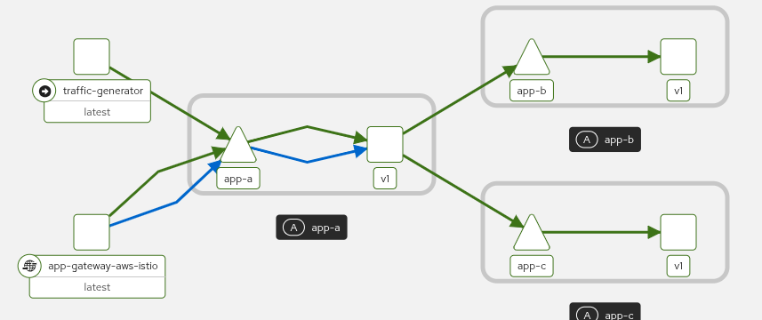
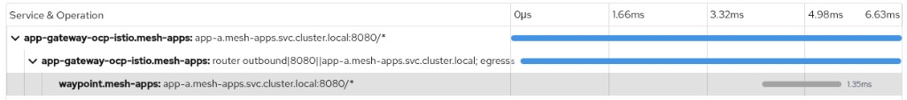

# Distributed Tracing in Istio Ambient Mode: Interpretation Guide

## Who generates spans?

In ambient mode, **only L7 proxies** generate distributed tracing spans:


| Component         | Layer      | Generates spans?             | Notes                                            |
| ----------------- | ---------- | ---------------------------- | ------------------------------------------------ |
| **Istio Gateway** | L7 (Envoy) | Yes, 2 spans per request     | CLIENT (outbound) + SERVER (inbound)             |
| **Waypoint**      | L7 (Envoy) | Yes, 1 span per service call | Only for services with `istio.io/use-waypoint`   |
| **ztunnel**       | L4         | No                           | Only generates TCP metrics (bytes, connections)  |
| **Application**   | App        | Only if instrumented         | Requires OpenTelemetry SDK or header propagation |


**Key rule:** if a service does NOT have `istio.io/use-waypoint`, traffic to that service bypasses the waypoint, and **no tracing span is generated** for that hop.

## How to read a trace in the OCP console (Observe > Traces)

### Span names don't show the destination

Waypoint span names use the **listener** pattern, not the destination service:

```
app-a.mesh-apps.svc.cluster.local:8080/*
```

This means "the waypoint processed a request on the listener for app-a:8080". It does **NOT** tell you the final destination.

### Where to find the actual destination

Click on the waypoint span and look at these attributes in the right panel:


| Attribute                             | What it tells you                  | Example                                                   |
| ------------------------------------- | ---------------------------------- | --------------------------------------------------------- |
| `http.url`                            | The URL requested                  | `http://backend/app-c`                                    |
| `istio.source_canonical_service`      | Which app sent the request         | `app-a`                                                   |
| `istio.destination_canonical_service` | **Which app received the request** | `app-c`                                                   |
| `istio.destination_instance_name`     | The exact pod that served          | `app-c-79564658dd-fmb8k`                                  |
| `upstream_cluster`                    | The Envoy cluster routed to        | `inbound-vip|8080|http|app-c.mesh-apps.svc.cluster.local` |
| `http.status_code`                    | Response status                    | `200`                                                     |
| `response_size`                       | Bytes returned                     | `248`                                                     |


### Key attributes for troubleshooting


| Attribute                                                | Purpose                                                        |
| -------------------------------------------------------- | -------------------------------------------------------------- |
| `istio.source_workload` / `istio.destination_workload`   | Pod owner (Deployment name)                                    |
| `istio.source_namespace` / `istio.destination_namespace` | Namespace of source/destination                                |
| `response_flags`                                         | Envoy flags (e.g., `NR` = no route, `UH` = upstream unhealthy) |
| `guid:x-request-id`                                      | Unique request ID for log correlation                          |


## Trace patterns: linear vs fan-out


### Linear pattern (mesh-apps)

```
Client -> Gateway -> app-a (nginx) -> backend -> app-c
```

Spans generated:

1. **Gateway CLIENT**: `router outbound|8080||app-a...` (gateway sending to app-a)
2. **Gateway SERVER**: `app-a.mesh-apps...:8080/*` (gateway received the request)
3. **Waypoint SERVER**: `app-a.mesh-apps...:8080/*` (waypoint routing app-a -> app-c)

Total: **3 spans** per request. The waypoint span attributes confirm app-c is the destination.

The reason there are only 3 spans (not 4+) is that nginx in app-a simply proxies to backend. The waypoint generates **one combined span** for the hop, showing both source (app-a) and destination (app-c) in the attributes.

**Kiali topology** showing traffic flow through app-a to app-b and app-c via waypoint:



**Tempo trace** showing the 3 correlated spans (2 gateway + 1 waypoint):



To confirm app-c is the actual destination, click on the `waypoint.mesh-apps` span and check the attribute `istio.destination_canonical_service: app-c`.

### Fan-out pattern (bookinfo)

```
Client -> Gateway -> productpage -> details
                                 -> reviews -> ratings
```

Spans generated:

1. **Waypoint**: productpage inbound (client -> productpage)
2. **Waypoint**: productpage -> details (separate HTTP call)
3. **Waypoint**: productpage -> reviews (separate HTTP call)

Total: **3+ spans** per request, branching out. Each separate HTTP call from productpage to a downstream service generates its own waypoint span.

### Why the difference?


|                   | mesh-apps                  | bookinfo                                 |
| ----------------- | -------------------------- | ---------------------------------------- |
| Frontend app      | nginx (reverse proxy)      | productpage (Python + OpenTelemetry SDK) |
| Outbound calls    | 1 (to backend)             | 2+ (to details, reviews)                 |
| Spans per request | 3 (2 gateway + 1 waypoint) | 3+ (all waypoint)                        |
| Trace shape       | Linear chain               | Branching tree                           |


The number of waypoint spans depends on **how many separate service-to-service calls** go through a waypoint, not on how many services exist.

## use-waypoint label: when is it needed?


| Use case               | Needed?      | Why                                      |
| ---------------------- | ------------ | ---------------------------------------- |
| L7 routing (HTTPRoute) | **Yes**      | Waypoint enforces path-based routing     |
| L7 AuthorizationPolicy | **Yes**      | Waypoint enforces HTTP-level policies    |
| Tracing only           | **Optional** | Adds the service to the tracing pipeline |


In this PoC:

- `backend`, `app-b`, `app-c`: need waypoint for HTTPRoute routing (ADR-0007)
- `app-a`: has waypoint **only for traceability** (documented in `charts/apps/templates/app-a.yaml`)


## Trace context propagation

For spans to be **correlated** (same trace ID), the application must propagate trace context headers. In this PoC:

- **nginx (app-a)**: propagates headers via `proxy_set_header` in the ConfigMap:
  - W3C: `traceparent`, `tracestate`
  - B3: `x-b3-traceid`, `x-b3-spanid`, `x-b3-parentspanid`, `x-b3-sampled`, `x-b3-flags`
  - Envoy: `x-request-id`
- **bookinfo productpage**: propagates headers via OpenTelemetry Python SDK (automatic)

If an application does **not** propagate these headers, downstream spans will appear as **separate traces** (different trace IDs), not as part of the same end-to-end trace.

## Querying traces via CLI

```bash
# Port-forward to Tempo gateway
oc port-forward -n tempo svc/tempo-tempo-gateway 18080:8080

TOKEN=$(oc whoami -t)

# Search recent traces by service name
curl -sk -H "Authorization: Bearer $TOKEN" \
  "https://localhost:18080/api/traces/v1/dev/tempo/api/search?limit=5&tags=service.name%3Dapp-gateway-ocp-istio.mesh-apps"

# Get a specific trace by ID
curl -sk -H "Authorization: Bearer $TOKEN" \
  "https://localhost:18080/api/traces/v1/dev/tempo/api/traces/<TRACE_ID>"
```

Note the URL pattern for multi-tenant Tempo: `/api/traces/v1/{tenant}/tempo/api/...`

## References

- ADR-0009: Observability stack (operator choices)
- ADR-0007: Waypoint L7 path routing
- ADR-0011: nginx apps and virtual backend
- [SM3 3.3 Distributed Tracing](https://docs.redhat.com/en/documentation/red_hat_openshift_service_mesh/3.3/html/observability/distributed-tracing-and-service-mesh)
- [Istio issue #56467](https://github.com/istio/istio/issues/56467): Ambient mode waypoint span behavior

